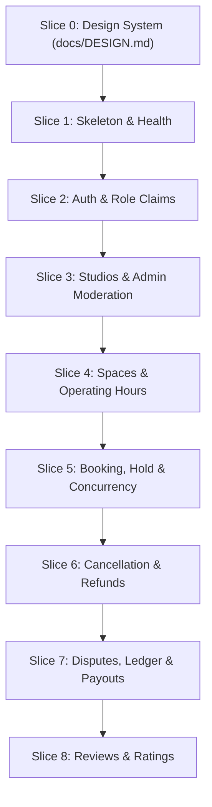

# Implementation Plan: Studio Booking Marketplace Platform

> **Governing Specification**: [docs/spec.md](file:///D:/Projects/StudioBooking/docs/spec.md)

---

## 1. Architectural Strategy & Design Principles

The application is structured in **Vertical Slices**, where each feature slice delivers functional backend domain logic, persistence, API endpoints, Arabic RTL frontend interface, and comprehensive automated tests before proceeding to the next slice.

- **Domain Clock Isolation**: The Domain layer **never reads the clock**. System clock calls (`DateTimeOffset.UtcNow`, `DateTime.Now`) are strictly forbidden in `StudioBooking.Domain`. All time-sensitive methods accept `DateTimeOffset now` as an explicit parameter, supplied by an injectable `TimeProvider` in the Application layer.
- **Double-Booking Prevention**: Database-level PostgreSQL `btree_gist` extension with `tstzrange` exclusion constraint on `SpaceId` and active statuses (`PendingPayment`, `Confirmed`), mapped to HTTP 409 Conflict.
- **Atomic Stale Hold Expiration**: Prior to inserting any booking hold, stale `PendingPayment` holds for that space are expired to `PaymentFailed` in the **exact same database transaction**.
- **String Enum Persistence**: `BookingStatus` is mapped using `.HasConversion<string>()` to ensure raw SQL exclusion constraints align seamlessly with EF Core queries.
- **Dispute Math & Parity**: Strict formula `OwnerGross = Deposit - CustomerRefund`, `Commission = Round(10% x OwnerGross, 2, AwayFromZero)`, `OwnerNet = OwnerGross - Commission`. Guaranteed parity with the standard non-dispute formula when `CustomerRefund = 0`.
- **Escrow & Ledger Payouts**: Deposits are held in platform escrow; owner payouts are released only after the **48-hour post-session dispute window** elapses with no dispute, tracked via an immutable double-entry ledger.
- **Operating Hours Boundary**: Operating hours are strictly same-day (`OpeningTime < ClosingTime`); overnight (cross-midnight) hours are out of scope for MVP.
- **Review Integrity**: Reviews are allowed only on undisputed `Completed` bookings; reviews after `DisputeResolved` are strictly prohibited.
- **Owner-Only Authorization**: Every write and read of owner-scoped resources is validated against the authenticated user's ID with dedicated authorization tests.
- **Arabic RTL-First Frontend**: Tailored UI layout (`dir="rtl"`), Arabic fonts (`Cairo`), with full design tokens documented in `docs/DESIGN.md`.

---

## 2. Technical Stack

| Area | Technologies |
|---|---|
| **Backend** | ASP.NET Core 9 Web API, Clean Architecture (Domain, Application, Infrastructure, Api) |
| **Database** | PostgreSQL 16+ with `btree_gist` extension, Entity Framework Core 9 (`Npgsql.EntityFrameworkCore.PostgreSQL`) |
| **Testing** | xUnit, FluentAssertions, Microsoft.AspNetCore.Mvc.Testing, Testcontainers / local PostgreSQL |
| **Frontend** | React 18/19, TypeScript, Vite, Tailwind CSS (RTL configured), Lucide React, Axios |
| **Design System** | `docs/DESIGN.md` — Arabic RTL-first token architecture (to be created in Slice 0) |

---

## 3. Vertical Slices Roadmap



---

### Slice 0: Design System & Token Foundation
- **Goal**: Establish the visual identity, Arabic RTL layout foundations, component standards, and design tokens prior to any frontend implementation.
- **Artifact**: Create [docs/DESIGN.md](file:///D:/Projects/StudioBooking/docs/DESIGN.md) covering:
  - Color palette (primary brand, secondary, neutral, success, warning, destructive)
  - Typography (`Cairo` font, Arabic text scale, weights, line heights)
  - RTL directional rules, padding, margins, flex layouts, icon orientation
  - Component primitives (Buttons, Inputs, Cards, Modals, Status Badges)

---

### Slice 1: Solution Skeleton & Database Foundation
- **Backend**:
  - Scaffold Clean Architecture solution:
    - `src/StudioBooking.Domain`
    - `src/StudioBooking.Application`
    - `src/StudioBooking.Infrastructure`
    - `src/StudioBooking.Api`
    - `tests/StudioBooking.Domain.UnitTests`
    - `tests/StudioBooking.Application.UnitTests`
    - `tests/StudioBooking.Api.IntegrationTests`
  - Configure EF Core `StudioBookingDbContext` with PostgreSQL.
  - Initial migration:
    - Add `CREATE EXTENSION IF NOT EXISTS btree_gist;`
  - Add `/health` endpoint returning database connectivity status.
- **Frontend**:
  - Initialize Vite + React + TypeScript in `frontend/`.
  - Configure Tailwind CSS with RTL support, `Cairo` font, and base layout.
  - Fetch and display `/health` status on screen.
- **Tests**:
  - `dotnet test`: passes solution build and integration health-check test.
  - `npm run build`: verifies clean frontend compilation.

---

### Slice 2: Authentication & Role-Based Authorization
- **Backend**:
  - `User` entity (`Id`, `Email`, `PasswordHash`, `FullName`, `PhoneNumber`, `Role`: Admin, StudioOwner, Customer).
  - Password hashing service and JWT token generator with role claims.
  - Endpoints: `POST /api/auth/register`, `POST /api/auth/login`, `GET /api/auth/me`.
  - Middleware: JWT bearer authentication, ClaimsPrincipal extraction, `ICurrentUserService`.
- **Frontend**:
  - Arabic RTL Auth pages: Login and Register with role selection tabs (Customer vs Studio Owner).
  - Auth context and Axios interceptors for JWT storage.
- **Tests**:
  - Unit tests for password hashing and JWT claims generation.
  - Integration tests for registration, login, invalid credentials, and role enforcement.

---

### Slice 3: Studio Management & Admin Moderation
- **Backend**:
  - `Studio` aggregate (`Id`, `OwnerId`, `Name`, `Description`, `Address`, `City`, `Status`, `RejectionReason`).
  - State machine: `Draft` $\to$ `PendingApproval` $\to$ `Approved` / `Rejected` / `Suspended`.
  - Commands & Queries: `CreateStudio`, `UpdateStudio`, `SubmitStudioForApproval`, `ApproveStudio`, `RejectStudio`, `GetMyStudios`, `GetPendingStudios`.
  - **Owner-Only Authorization**: Studio Owner can only edit/submit their own studios.
- **Frontend**:
  - Studio Owner Portal: Studio profile form, list of owner's studios with Arabic status badges.
  - Admin Portal: Moderation queue listing pending studios with Approve / Reject modal (with rejection reason).
- **Tests**:
  - Domain unit tests for Studio state transitions.
  - Application authorization tests: Studio Owner B cannot edit Studio Owner A's studio (HTTP 403).
  - Admin approval workflow integration tests.

---

### Slice 4: Spaces & Operating Hours Management
- **Backend**:
  - `Space` entity (`Id`, `StudioId`, `Name`, `Category`, `HourlyRate`, `MinBookingHours`, `Capacity`, `OpeningTime`, `ClosingTime` [AST], `Amenities`, `IsActive`).
  - **Domain Invariants**:
    - `HourlyRate > 0`, `MinBookingHours >= 1`.
    - **No Overnight Operating Hours in MVP**: Require `OpeningTime < ClosingTime` within the same calendar day. Cross-midnight hours throw `InvalidOperatingHoursException`.
  - Commands & Queries: `CreateSpace`, `UpdateSpace`, `ToggleSpaceActive`, `GetSpacesByStudio`, `GetMarketplaceSpaces` (filtered: only active spaces from approved studios).
  - **Owner-Only Authorization**: Only the studio owner can manage spaces in their studio.
- **Frontend**:
  - Studio Owner: Space management view inside studio dashboard (hourly rate in SAR, min hours, daily same-day opening/closing hours, equipment checklist).
  - Customer: Marketplace catalog with filters (city, category, rate range, capacity). Space details view showing operating hours and equipment.
- **Tests**:
  - Domain unit tests for Space creation, validation rules, operating hours validation (`OpeningTime < ClosingTime`), and active toggling.
  - Domain unit tests rejecting cross-midnight operating hours (e.g. 22:00 to 02:00).
  - Authorization unit tests ensuring non-owners cannot mutate spaces.
  - Query tests verifying unapproved studios/spaces are hidden from marketplace search.

---

### Slice 5: Booking, Hold & Concurrency Protection
- **Backend**:
  - **Domain Clock Rule**: All domain methods accept `DateTimeOffset now`. No direct system clock access in Domain.
  - `Booking` entity with price snapshots (`HourlyRateSnapshot`, `SpaceNameSnapshot`), `TimeRange` (1-hour increments, $\ge$ `MinBookingHours`, strictly within same-day `OpeningTime`-`ClosingTime` in AST).
  - `Money` Value Object with `MidpointRounding.AwayFromZero`.
  - Financial calculations: 20% deposit, 80% on-site, 10% platform fee, 90% owner payout.
  - State machine: `PendingPayment` (15-min hold) $\to$ `Confirmed` $\to$ `Completed` (auto after `TimeRange.End`) or `PaymentFailed`.
  - **EF Core Mapping**:
    - `BookingStatus` stored as string: `.Property(b => b.Status).HasConversion<string>().HasMaxLength(50)`.
  - **PostgreSQL Exclusion Constraint (`tstzrange`)**:
    ```sql
    ALTER TABLE "Bookings"
    ADD CONSTRAINT "no_overlapping_active_bookings"
    EXCLUDE USING gist (
        "SpaceId" WITH =,
        tstzrange("StartTime", "EndTime", '[)') WITH &&
    )
    WHERE ("Status" IN ('PendingPayment', 'Confirmed'));
    ```
  - **Atomic Stale Hold Expiration in Same Transaction**:
    - Before inserting a new booking in `CreateBookingCommandHandler`, an atomic update runs in the **exact same database transaction**:
      ```sql
      UPDATE "Bookings"
      SET "Status" = 'PaymentFailed'
      WHERE "SpaceId" = @SpaceId
        AND "Status" = 'PendingPayment'
        AND "CreatedAt" + INTERVAL '15 minutes' < @Now;
      ```
  - Exception filter mapping PostgreSQL constraint violation `23P01` $\to$ **HTTP 409 Conflict**.
  - In-app notification dispatcher on booking confirmation and payment failure.
  - Endpoints: `POST /api/bookings` (initiate hold), `POST /api/bookings/{id}/pay-deposit` (confirm), `GET /api/bookings/my`, `GET /api/notifications`.
- **Frontend**:
  - Customer: Interactive slot picker (enforcing min hours and operating hours in AST), price breakdown modal (Total, 20% Deposit, 80% On-Site in SAR), simulated payment checkout with 15-minute countdown timer.
  - Studio Owner: Incoming bookings list, calendar, and in-app notifications bell.
- **Tests**:
  - Unit tests for `Money` rounding boundaries (`MidpointRounding.AwayFromZero`).
  - Unit tests for deposit and commission formulas.
  - Unit tests for operating hours rejection (booking outside opening/closing times or spanning midnight).
  - **Domain Clock Unit Tests**: Verify `ExpireHold(now)`, `AutoComplete(now)` operate deterministically without system clock calls.
  - **Atomic Stale Hold Expiration Test**: Unit and integration test verifying that an expired `PendingPayment` hold on Space X does not block a new booking for the same slot, and is updated to `PaymentFailed` within the transaction.
  - **Concurrency Integration Test**: Spawn 10 parallel threads attempting to book the exact same space and time slot; verify strictly 1 receives 200/201 and 9 receive 409 Conflict.

---

### Slice 6: Cancellation & Refunds
- **Backend**:
  - Customer cancellation rules (`booking.CancelByCustomer(DateTimeOffset now)`):
    - **Guard**: Requires `now < Start`. If `now >= Start`, throws `BookingAlreadyStartedException` (cancellation not allowed after session start).
    - If $\text{now} \le \text{Start} - 24\text{h} \implies$ Status `Cancelled`, 100% deposit refund, 0 owner payout, 0 platform commission.
    - If $\text{Start} - 24\text{h} < \text{now} < \text{Start} \implies$ Status `Cancelled`, 0 refund to customer, owner credited net payout ($\text{Deposit} - \text{Commission}$).
  - Studio Owner cancellation rules (`booking.CancelByOwner(DateTimeOffset now)`):
    - **Guard**: Requires `now < Start`. Status `CancelledByOwner`, 100% deposit refund to customer regardless of timing.
  - Endpoints: `POST /api/bookings/{id}/cancel`.
- **Frontend**:
  - Customer: Cancel booking button with dynamic confirmation modal warning whether the deposit is refundable or non-refundable based on the 24-hour rule (disabled after session start).
  - Studio Owner: Cancel booking button with alert that deposit will be refunded to customer.
- **Tests**:
  - Domain unit tests for cancellation at 25h prior (100% refund) and 23h prior (0% refund).
  - Domain unit test rejecting customer cancellation once session has started (`now >= Start`).
  - Domain unit tests for owner cancellation before start.
  - Integration tests for cancellation endpoint and refund ledger entries.

---

### Slice 7: Disputes, Ledger & Owner Payouts
- **Backend**:
  - `Dispute` entity (`Id`, `BookingId`, `RaisedByUserId`, `RaisedByRole`, `Reason`, `Status`, `CustomerRefund`, `OwnerGross`, `OwnerNet`, `Commission`, `AdminNotes`, `CreatedAt`, `ResolvedAt`).
  - Validation: Raised within **48 hours after `TimeRange.End`** (`now <= TimeRange.End + 48h`) for `Confirmed` or `Completed` bookings.
  - **Dispute Mathematical Model**:
    $$\text{OwnerGross} = \text{DepositAmount} - \text{CustomerRefund}$$
    $$\text{Commission} = \text{Round}(\text{OwnerGross} \times 0.10, 2, \text{MidpointRounding.AwayFromZero})$$
    $$\text{OwnerNet} = \text{OwnerGross} - \text{Commission}$$
    Invariant: $\text{CustomerRefund} + \text{OwnerNet} + \text{Commission} == \text{DepositAmount}$.
  - **Owner Payout Release Timing**:
    - Held in escrow during session and throughout 48-hour post-session dispute window.
    - If no dispute raised after 48h (`now >= TimeRange.End + 48h`), booking marked `PayoutReleased`.
    - If disputed, payout held until Admin resolution (`DisputeResolved`).
  - **Double-Entry Append-Only Ledger (`LedgerEntries`)**:
    - Deposit payment: Debit `Gateway`, Credit `EscrowHeld`.
    - Payout release (after 48h no-dispute): Debit `EscrowHeld`, Credit `CommissionRevenue`, Credit `OwnerPayable`.
    - Dispute resolution: Debit `EscrowHeld`, Credit `CustomerRefundPayable`, Credit `CommissionRevenue`, Credit `OwnerPayable`.
  - Endpoints: `POST /api/bookings/{id}/dispute`, `POST /api/admin/disputes/{id}/resolve`, `GET /api/owner/ledger-balance`.
- **Frontend**:
  - Customer & Owner: "رفع نزاع" (Raise Dispute) button on eligible bookings within the 48-hour window with structured reason form.
  - Admin Portal: Dispute arbitration table with refund slider and live breakdown of `CustomerRefund`, `OwnerGross`, `Commission`, and `OwnerNet`.
  - Studio Owner Portal: Payout balance card and ledger transaction history.
- **Tests**:
  - Domain unit test: 48-hour dispute window guard (accepted at 47h, rejected at 49h).
  - **Dispute Math Tests**:
    - Parity test with standard formula when `CustomerRefund = 0` (e.g. Deposit 200 $\implies$ Gross 200, Comm 20, Net 180).
    - Parity test when `CustomerRefund = Deposit` (Gross 0, Comm 0, Net 0).
    - Partial split test (Deposit 100, Refund 40 $\implies$ Gross 60, Comm 6, Net 54).
    - Fractional rounding test with `AwayFromZero` precision (Deposit 105.50, Refund 30.25 $\implies$ Gross 75.25, Comm 7.53, Net 67.72).
  - Payout release eligibility unit tests (`IsPayoutEligible(now)`).
  - Ledger double-entry balance verification tests.

---

### Slice 8: Reviews & Ratings
- **Backend**:
  - `Review` entity (`Id`, `SpaceId`, `BookingId`, `CustomerId`, `Rating` 1–5, `Comment`, `CreatedAt`).
  - **Domain Invariants**:
    - Booking must be in `Completed` status.
    - **Review Prohibited After DisputeResolved**: Attempting to submit a review for a booking that was disputed or resolved via dispute throws `InvalidOperationException`. Only undisputed `Completed` bookings are eligible.
    - Exactly 1 review per booking.
    - Rating integer: $1 \le \text{Rating} \le 5$.
  - Endpoints: `POST /api/spaces/{id}/reviews`, `GET /api/spaces/{id}/reviews`.
- **Frontend**:
  - Customer: Post-session review prompt with star selector and text input (hidden or disabled if booking was disputed).
  - Public Space Page: Display average rating, review count, and customer comments.
- **Tests**:
  - Domain unit tests: rejecting reviews on uncompleted or cancelled bookings.
  - **Review After Dispute Test**: Domain unit test verifying that a booking with status `DisputeResolved` (or `Disputed`) rejects review creation with an error.
  - Rating range boundary tests ($0$ fails, $1$ passes, $5$ passes, $6$ fails).
  - Integration tests for submitting and querying reviews.

---

## 4. Immediate Next Step

Wait for user approval of this updated specification and plan. Once approved, the next task will be:
- **Slice 0**: Create [docs/DESIGN.md](file:///D:/Projects/StudioBooking/docs/DESIGN.md) establishing color tokens, Arabic typography, RTL guidelines, and component standards.
